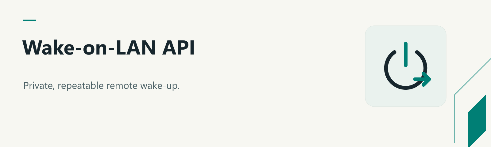
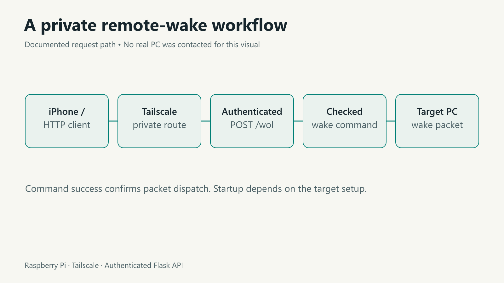

# Wake-on-LAN API



**Wake a remote PC through a private, repeatable workflow.**

A Flask API running on a Raspberry Pi or Linux host sends a Wake-on-LAN packet to one configured PC. Tailscale provides a private route to that host; an iPhone Shortcut or HTTP client triggers the request.

```text
iPhone / client → Tailscale → Flask API → wakeonlan → target PC
```



## Requirements

- Python 3.10+ on an always-on Linux host.
- The `wakeonlan` command installed on that host.
- Wake-on-LAN enabled in the target PC's firmware and operating system.
- A usable network path for the magic packet; wired Ethernet is commonly required.
- Tailscale configured on the server and client for access away from home.

## Quick start

```sh
sudo apt install python3-venv wakeonlan
python3 -m venv .venv
. .venv/bin/activate
pip install -r requirements.txt
cp .env.example .env
python -c "import secrets; print(secrets.token_urlsafe(32))"
```

Set the generated token as `WOL_API_TOKEN` in `.env`, replace `WOL_TARGET_MAC`, and check the broadcast address. The server binds to `127.0.0.1` by default. For VPN access, set `WOL_BIND_HOST` to the server's specific Tailscale IP. Do not forward this API to the public internet.

For a local check, run `python server.py`. For a persistent Linux deployment, follow [the service guide](docs/deployment.md).

## API

`GET /health` returns application health without sending a packet. `POST /wol` requires a bearer token and accepts no target MAC or command from the request.

```sh
curl --request POST http://127.0.0.1:5000/wol \
  --header "Authorization: Bearer $WOL_API_TOKEN"
```

A successful response means the command sent a packet, **not** that the PC has finished starting. Missing authentication returns 401; missing dependencies, command failures and timeouts return 503, 502 and 504 respectively.

## iPhone Shortcut

Add the server's Tailscale URL ending in `/wol`, then **Get Contents of URL**. Select **POST** and add an `Authorization` header with `Bearer <your token>`. Keep the token private.

**Migration:** the original README-only example used unauthenticated `GET /wol`. The runnable implementation requires authenticated POST; update existing shortcuts. Nothing here changes an already installed service automatically.

## Tests

```sh
pip install -r requirements-dev.txt
python -m pytest -q
```

Tests mock the wake command and do not wake a real PC. Hardware, firmware and network configuration must be verified on your own setup. This repository currently has no explicit license grant.
